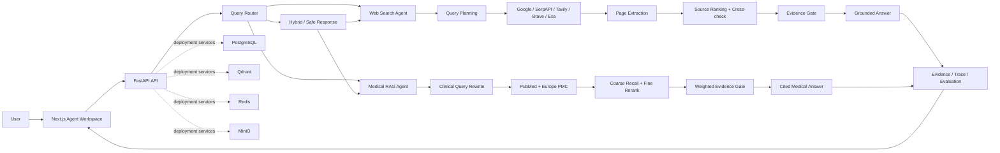

# WMD-agent

> Web & Medical Discovery Agent: an evidence-first QA workspace for live web research and medical literature retrieval.

[](https://nextjs.org/)
[](https://fastapi.tiangolo.com/)
[](https://www.python.org/)
[](https://www.typescriptlang.org/)

WMD-agent 不是一个只依赖模型记忆的聊天框。它将系统拆成两条相互独立、但可以在 Hybrid 模式中组合的证据链：

- **Web Search Agent**：面向价格、政策、新闻、院校、旅行和其他动态问题，执行在线搜索、页面抽取、来源排序、交叉验证，再由模型生成带引用的回答。
- **Medical RAG Agent**：面向医学证据问题，只允许 PubMed / Europe PMC 文献进入医学结论，并通过多轮召回、重排和 Evidence Gate 控制回答强度。

核心原则只有一句：**先找证据，再判断证据是否足够，最后回答。**

## 项目亮点

- Web Search 与 Medical RAG 使用独立页面、独立接口和独立证据面板。
- Basic / Advanced 两种运行级别，可直观看到检索策略差异。
- 同一会话具备上下文能力，追问会结合最近对话转换成独立检索问题。
- 每次运行显示 Route、Agent Timeline、Evidence Gate、延迟和来源卡片。
- Medical RAG 严格过滤非 PubMed / Europe PMC 记录，不用网页百科或演示数据代替医学证据。
- Advanced Medical RAG 最多执行三轮 query rewrite 与召回；达到默认 `0.70` 门槛后直接生成答案。
- 回答与证据分栏：中间区域只呈现面向用户的最终回答，右侧集中展示 PMID、DOI、期刊、研究类型、snippet 和分数。
- 新开页面默认创建空白会话；历史会话保存在浏览器本地，可从 History 页面恢复。
- 支持 Google Custom Search、SerpAPI、Tavily、Brave Search、Exa，以及不稳定的无密钥 HTML fallback。
- 支持 OpenAI-compatible `chat/completions` 接口进行基于证据的 Web 答案综合。

## 系统架构



> PostgreSQL、Qdrant、Redis 和 MinIO 已包含在部署骨架中。当前 MVP 的问答运行记录仍使用内存存储，浏览器会话历史使用 `localStorage`；真实向量索引、账户级持久化和全文对象存储见下方 Roadmap。

## 两条 Agent 流程

### Web Search Agent

```text
Question
  -> Conversation Context Resolution
  -> Search Query Planning
  -> Multi-provider Online Search
  -> Page Extraction (Advanced)
  -> Source Credibility Ranking
  -> Evidence Sentence Selection
  -> Cross-source Verification
  -> Evidence Sufficiency Check
  -> LLM Grounded Synthesis
  -> Cited Final Answer
```

Web Agent 不是固定问题模板。它接收任意通用问题，并在每次请求时重新在线检索。`SEARCH_PROVIDER=auto` 会按配置尝试：

```text
Google Custom Search -> SerpAPI Google -> Tavily -> Brave -> Exa
```

随后再尝试 DuckDuckGo / Bing HTML fallback。公共 HTML 搜索可能触发反爬限制，因此正式部署至少应配置一个搜索 API。要获得“搜索后再由大模型总结”的完整体验，还需配置 `OPENAI_API_KEY`；没有模型密钥时，系统会退回到确定性 evidence synthesizer，并明确显示实际使用的模型版本。

### Medical RAG Agent

```text
Medical Question
  -> Conversation Context Resolution
  -> Medical Concept Expansion
  -> PubMed / Europe PMC Search
  -> Authoritative Source Audit
  -> BM25-like + Dense-proxy Coarse Recall
  -> Metadata-aware Fine Ranking
  -> Top-K Evidence Selection
  -> Weighted Evidence Gate
  -> Cited Final Answer or Conservative Refusal
```

Basic 与 Advanced 的区别：

| 能力 | Basic RAG | Advanced RAG |
| --- | --- | --- |
| Query | 单条医学概念 query | Multi-query rewrite，最多 3 轮 |
| 召回 | 单轮粗召回 | 扩展召回池并逐轮去重 |
| 排序 | lexical / dense proxy 综合分 | metadata-aware rerank + Top-K |
| 证据判断 | 单轮 Evidence Gate | 每轮 Gate，低于门槛继续召回 |
| 失败行为 | 保守回答或证据不足 | 三轮后仍不足则拒绝强结论 |
| 来源 | PubMed / Europe PMC | PubMed / Europe PMC |

Pure Medical RAG 不会把普通网页混入医学证据。需要论文证据与最新网页信息共同回答时，请使用 `/chat` 的 Hybrid 模式。

## Evidence Gate

每条医学证据不是只看相似度，而是进行加权评分：

```text
Evidence Score =
  0.30 * Rerank Score
+ 0.20 * Retrieval Similarity
+ 0.20 * Source Quality
+ 0.15 * Evidence Directness
+ 0.10 * Recency
+ 0.05 * Study Type Quality
```

回答等级：

| 等级 | 条件 | 系统行为 |
| --- | --- | --- |
| Strong | `score >= 0.70` 且至少 3 条证据 | 生成正常的带引用回答 |
| Moderate | `score >= 0.55` 且至少 2 条证据 | 回答，同时明确限制 |
| Weak | `score >= 0.40` | Advanced 模式继续改写和召回 |
| Insufficient | `score < 0.40` | 不输出确定医学结论 |

`RAG_CONFIDENCE_THRESHOLD` 控制 Advanced Medical RAG 的直接返回门槛，默认值为 `0.70`。

## 页面

| 路径 | 用途 |
| --- | --- |
| `/` | 项目入口与核心能力概览 |
| `/web-search` | 独立的在线 Web QA 工作区 |
| `/medical-rag` | 独立的医学文献 RAG 工作区 |
| `/chat` | Auto / Web / Medical / Hybrid 路由工作区 |
| `/literature` | PubMed / Europe PMC 文献搜索与导入 |
| `/evidence` | 已记录证据浏览 |
| `/evaluation` | Trace 派生的 MVP 指标面板 |
| `/history` | 本地会话历史、筛选、恢复与删除 |
| `/settings` | 运行配置说明 |

工作区采用三栏布局：

```text
+-------------------+----------------------------+----------------------+
| Route / Controls  | Final answer conversation  | Evidence Review      |
| Current step      | Previous turns             | Source cards         |
| Basic / Advanced  | Current grounded answer    | PMID / DOI / scores  |
+-------------------+----------------------------+----------------------+
```

## 技术栈

**Frontend**

- Next.js 15 + React 19 + TypeScript
- Tailwind CSS
- TanStack React Query
- Lucide icons

**Backend**

- FastAPI + Pydantic Settings
- HTTPX + BeautifulSoup + lxml
- PubMed NCBI E-utilities + Europe PMC REST API
- OpenAI-compatible chat completion endpoint
- pytest + Ruff

**Deployment services**

- PostgreSQL 16
- Qdrant
- Redis 7 + RQ worker
- MinIO
- Docker Compose

## 项目结构

```text
.
├── frontend/
│   ├── app/                       # App Router pages
│   ├── components/
│   │   ├── chat/                  # Agent workspace
│   │   ├── evidence/              # Evidence cards
│   │   ├── layout/                # Global application shell
│   │   └── ui/                    # Shared UI controls
│   ├── lib/
│   │   ├── api.ts                 # Backend client
│   │   ├── chat-history.ts        # Browser session persistence
│   │   └── types.ts               # API types
│   └── package.json
├── backend/
│   ├── app/
│   │   ├── agents/                # Router, context, web workflow
│   │   ├── api/                   # FastAPI routes
│   │   ├── core/                  # Runtime settings
│   │   ├── db/                    # Persistence models / session layer
│   │   ├── rag/                   # Retrieval, rerank, confidence gate
│   │   ├── schemas/               # Request / response contracts
│   │   ├── search/                # Web and literature clients
│   │   ├── services/              # LLM, synthesis, run store
│   │   └── main.py
│   ├── tests/
│   ├── Dockerfile
│   └── pyproject.toml
├── worker/                         # Background worker entry point
├── docs/                           # Architecture, RAG, evaluation, UI notes
├── docker-compose.yml
├── .env.example
└── README.md
```

## 快速开始

### 1. 准备环境变量

```bash
cp .env.example .env
```

至少推荐配置一组搜索凭据和一个模型凭据：

```env
# Grounded answer synthesis
OPENAI_API_KEY=your_key
LLM_BASE_URL=https://api.openai.com/v1
LLM_MODEL=gpt-4o-mini

# Choose at least one search provider
TAVILY_API_KEY=your_key
# BRAVE_SEARCH_API_KEY=your_key
# EXA_API_KEY=your_key
# SERPAPI_API_KEY=your_key
# GOOGLE_SEARCH_API_KEY=your_key
# GOOGLE_SEARCH_CX=your_search_engine_id

# Recommended for NCBI usage identification / higher rate limits
NCBI_EMAIL=you@example.com
NCBI_API_KEY=
```

不要把 `.env` 提交到 Git。所有搜索和模型密钥只应存在后端环境中。

### 2. 启动后端

需要 Python 3.11 或更高版本。

```bash
cd backend
python3 -m venv .venv
source .venv/bin/activate
pip install -e ".[dev]"
uvicorn app.main:app --reload --port 8000
```

检查：

```bash
curl http://localhost:8000/api/health
```

预期返回：

```json
{"status":"ok","service":"wmd-agent-backend"}
```

### 3. 启动前端

新开一个终端：

```bash
cd frontend
npm install
npm run dev
```

访问：

- Web UI: [http://localhost:3000](http://localhost:3000)
- Web Search Agent: [http://localhost:3000/web-search](http://localhost:3000/web-search)
- Medical RAG Agent: [http://localhost:3000/medical-rag](http://localhost:3000/medical-rag)
- API Docs: [http://localhost:8000/docs](http://localhost:8000/docs)

当前 MVP 的 Web / Medical 问答路径无需先启动 PostgreSQL 或 Qdrant；这些服务用于后续持久化和真实向量检索。

## Docker Compose

启动完整服务栈：

```bash
cp .env.example .env
docker compose up --build
```

后台启动：

```bash
docker compose up -d --build
docker compose ps
```

停止服务：

```bash
docker compose down
```

如需同时删除数据库、向量库和对象存储卷，请明确确认数据不再需要后再执行：

```bash
docker compose down -v
```

## 关键环境变量

| 变量 | 默认值 | 说明 |
| --- | --- | --- |
| `OPENAI_API_KEY` | empty | 开启真实模型的 grounded Web summary |
| `LLM_BASE_URL` | `https://api.openai.com/v1` | OpenAI-compatible API 根地址 |
| `LLM_MODEL` | `gpt-4o-mini` | 最终 Web 答案综合模型 |
| `CORS_ORIGINS` | local frontend URLs | 允许访问后端的前端来源，逗号分隔 |
| `SEARCH_PROVIDER` | `auto` | `auto/google/serpapi/tavily/brave/exa/html` |
| `GOOGLE_SEARCH_API_KEY` | empty | Google Custom Search API key |
| `GOOGLE_SEARCH_CX` | empty | Programmable Search Engine ID |
| `SERPAPI_API_KEY` | empty | SerpAPI Google 搜索 |
| `TAVILY_API_KEY` | empty | Tavily 搜索 |
| `BRAVE_SEARCH_API_KEY` | empty | Brave Search API |
| `EXA_API_KEY` | empty | Exa 搜索与内容结果 |
| `NCBI_EMAIL` | empty | NCBI 请求身份信息 |
| `NCBI_API_KEY` | empty | NCBI API key |
| `RAG_DEFAULT_TOP_K` | `20` | 每轮文献候选规模基准 |
| `RAG_RERANK_TOP_K` | `8` | 最终保留证据数量 |
| `RAG_CONFIDENCE_THRESHOLD` | `0.70` | Advanced RAG 直接返回门槛 |
| `DEMO_MODE` | `false` | 显式演示模式；生产应保持关闭 |
| `NEXT_PUBLIC_API_BASE_URL` | `http://localhost:8000` | 浏览器访问后端的公开地址 |

## API

主要接口：

| Method | Endpoint | Description |
| --- | --- | --- |
| `POST` | `/api/web/ask` | 强制执行 Web Search Agent |
| `POST` | `/api/medical/ask` | 强制执行 Medical RAG Agent |
| `POST` | `/api/chat` | Auto / Web / Medical / Hybrid 路由 |
| `POST` | `/api/search/web` | 原始 Web 搜索结果 |
| `POST` | `/api/search/pubmed` | PubMed / Europe PMC 文献搜索 |
| `POST` | `/api/rag/ask` | Medical RAG 兼容入口 |
| `POST` | `/api/rag/ingest` | 将论文及可选全文切分并登记 |
| `GET` | `/api/papers` | 已登记论文 |
| `GET` | `/api/papers/{paper_id}` | 单篇论文 metadata |
| `GET` | `/api/evidence/{answer_id}` | 某次回答的证据 |
| `GET` | `/api/traces/{run_id}` | Route 与 Agent trace |
| `GET` | `/api/eval/runs` | Evaluation runs |
| `POST` | `/api/eval/run` | 创建一次 MVP evaluation 汇总 |
| `GET` | `/api/health` | 健康检查 |

### Web Search 示例

```bash
curl -X POST http://localhost:8000/api/web/ask \
  -H 'Content-Type: application/json' \
  -d '{
    "question": "德国司美格鲁肽目前多少钱？",
    "mode": "web_search",
    "retrieval_level": "advanced",
    "evidence_strictness": "high",
    "language": "zh",
    "conversation_history": []
  }'
```

### Medical RAG 示例

```bash
curl -X POST http://localhost:8000/api/medical/ask \
  -H 'Content-Type: application/json' \
  -d '{
    "question": "GLP-1 药物和骨密度之间有什么研究证据？",
    "mode": "medical_rag",
    "retrieval_level": "advanced",
    "evidence_strictness": "high",
    "language": "zh",
    "filters": {
      "year_from": 2020,
      "study_type": ["clinical trial", "meta-analysis"],
      "open_access_only": false
    },
    "conversation_history": []
  }'
```

响应核心结构：

```json
{
  "answer": "...",
  "confidence": "moderate",
  "confidence_score": 0.64,
  "route": "medical_literature_rag",
  "evidence": [
    {
      "title": "...",
      "pmid": "...",
      "doi": "...",
      "journal": "...",
      "year": 2025,
      "study_type": "Review",
      "snippet": "...",
      "support_level": "direct",
      "retrieval_score": 0.78,
      "rerank_score": 0.86,
      "source_quality_score": 1.0
    }
  ],
  "limitations": ["..."],
  "trace_id": "run_xxx",
  "trace": ["..."],
  "latency_ms": 4200,
  "model_version": "gpt-4o-mini"
}
```

### 上下文追问

API 通过 `conversation_history` 接收最近对话。前端会自动传递同一会话中的历史轮次：

```json
{
  "question": "再推荐几个饭店",
  "conversation_history": [
    {
      "question": "介绍一下中国山东菏泽市",
      "answer": "...",
      "route": "web_search",
      "confidence": "strong",
      "evidence_titles": ["菏泽市人民政府", "菏泽市文化和旅游局"]
    }
  ]
}
```

后端先将追问转换为可独立检索的问题，再进入 query planning，避免把上一轮的地点、疾病或药物主题错误替换掉。

## 测试与质量检查

后端：

```bash
cd backend
source .venv/bin/activate
pytest
ruff check app tests
```

前端：

```bash
cd frontend
npm run typecheck
npm run build
```

当前自动化测试覆盖 Query Router、Evidence Gate、严格医学来源过滤，以及多轮地点上下文恢复。

## 当前完成度

| 模块 | 状态 | 说明 |
| --- | --- | --- |
| Web 多供应商在线搜索 | Available | 正式效果依赖至少一个 API key |
| Advanced 页面正文抽取 | Available | 抽取顶部候选页面的可读文本 |
| 来源排序与证据卡片 | Available | authority / relevance / recency 等信号 |
| 模型综合 Web 最终答案 | Available | 需要 `OPENAI_API_KEY`；否则确定性 fallback |
| PubMed / Europe PMC 检索 | Available | metadata + abstract 级别 |
| 严格医学来源审计 | Available | 排除 demo / web / wiki / commercial |
| 三轮 query rewrite + Evidence Gate | Available | Advanced Medical RAG |
| 会话上下文与 History | Available | 浏览器本地保存，最多 80 个 session |
| PostgreSQL / Qdrant / Redis / MinIO | Scaffolded | Compose 已配置，尚未成为默认问答存储路径 |
| Dense embedding / cross-encoder reranker | Planned | 当前为 lexical/dense proxy 与启发式 rerank |
| PMC OA 全文 RAG | Planned | 仅使用合规 OA bulk/OAI/FTP/cloud 来源 |
| RAGAS / DeepEval | Planned | 当前 dashboard 指标是 trace-derived MVP estimates |
| 用户登录与云端会话同步 | Planned | 当前无账号体系 |

## Roadmap

1. 接入 BGE-M3 / MedCPT / SPECTER2 embedding，并在 Qdrant 建立 dense + sparse hybrid collection。
2. 接入真实 cross-encoder 或 rerank API，将粗召回 Top 50-100 重排到 Top 5-8。
3. 使用 PMC Open Access Subset 的官方 OAI/FTP/cloud 渠道导入 XML/BioC 全文。
4. 增加 section-aware contextual chunking、研究类型识别和 entity expansion。
5. 将 run、paper、chunk、evidence、session 持久化到 PostgreSQL / Qdrant / MinIO。
6. 引入 RAGAS / DeepEval 数据集评估，并区分 faithfulness、citation precision、recall@k、MRR、nDCG、延迟和成本。
7. 增加认证、日志脱敏、速率限制、任务队列和生产监控。

## 生产部署建议

- 搜索 API 和模型 API key 只放在后端；不要使用 `NEXT_PUBLIC_*` 暴露密钥。
- 仅公开 Frontend 与 Backend，PostgreSQL、Qdrant、Redis、MinIO 应保留在内网。
- 使用 Nginx、Caddy 或云负载均衡器提供 HTTPS 与域名。
- 设置生产域名对应的 `CORS_ORIGINS` 和 `NEXT_PUBLIC_API_BASE_URL`，然后重新构建前端。
- 在保存真实用户问答前增加登录、权限、数据保留策略和敏感信息脱敏。
- 默认禁止上传带身份信息的病历；医学输出必须保留证据链接与非诊断声明。
- PMC 全文只能通过允许 text mining / reuse 的 Open Access 数据与官方批量渠道获取。

推荐反向代理关系：

```text
https://your-domain.example/      -> frontend:3000
https://your-domain.example/api/  -> backend:8000
```

## 医疗与版权说明

WMD-agent 是研究与工程演示项目，不提供个人诊断、处方或治疗建议。任何涉及症状、用药、检查或治疗决策的问题，都应由合格医疗专业人员结合完整病史判断。

PubMed / Europe PMC metadata 与摘要应按各数据源条款使用。PMC 中并非所有文章都允许批量 text mining 或再利用；全文导入应限制在 PMC Open Access Subset 及其官方提供的 OAI-PMH、FTP 或 Cloud Service 渠道。

---

**WMD-agent: search broadly, rank carefully, answer only as strongly as the evidence allows.**
