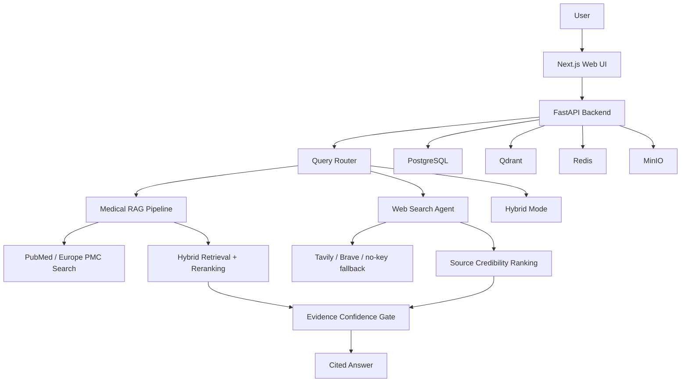

# Architecture

The MVP keeps persistence in memory so the app can be started quickly. The SQLAlchemy models and Docker services are already included so PostgreSQL/Qdrant integration can be added without changing the API contract.

## Backend Modules

- `api/routes.py`: public API endpoints
- `agents/router.py`: query type and risk routing
- `agents/web_search_agent.py`: search planning, web search, source ranking, synthesis
- `rag/pipeline.py`: literature search, retrieval, confidence gate, answer generation
- `rag/confidence.py`: evidence gate formula and answer labels
- `search/pubmed.py`: Europe PMC client with explicit demo fallback only when live literature access fails
- `search/web.py`: Tavily/Brave client with no-key fallback and explicit insufficient-evidence failure state
- `services/store.py`: MVP in-memory trace and evidence store

## Frontend Modules

- `/chat`: main agent workspace
- `/web-search`: dedicated dynamic Web Search Agent
- `/medical-rag`: dedicated Medical RAG Agent
- `/literature`: PubMed / Europe PMC search
- `/evidence`: local evidence library
- `/evaluation`: trace-derived metrics dashboard
- `/settings`: deployment and runtime configuration
